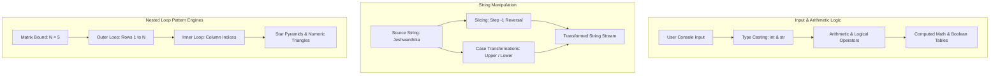

<div align="center">


[](https://www.python.org/)
[](#)
[](https://jupyter.org/)
[](#)

</div>

---

## 📌 Executive Summary / Overview

The **Python Fundamentals & Patterns Laboratory** (`python-assignment-01`) is a hands-on computational foundation suite covering core Python language mechanics, boolean truth-table logic, string manipulation, and nested-loop geometric pattern generation.

Mastery of control flow and loop invariant mechanics forms the bedrock of algorithmic problem-solving. This repository isolates essential algorithmic patterns: from arithmetic input parsing and step-indexed string slicing to multi-dimensional triangular number matrices, inverted star pyramids, and conditional branching.

---

## 📖 Interactive Table of Contents

- [Executive Summary / Overview](#-executive-summary--overview)
- [Key Features & Capabilities](#-key-features--capabilities)
- [System Architecture & Control Flow](#-system-architecture--control-flow)
- [Tech Stack Breakdown](#-tech-stack-breakdown)
- [Laboratory Modules & Computational Concepts](#-laboratory-modules--computational-concepts)
- [Reproducible Quickstart & Setup](#-reproducible-quickstart--setup)
- [Project Directory Layout](#-project-directory-layout)
- [Author & Contributions](#-author--contributions)

---

## ✨ Key Features & Capabilities

- **Algorithmic Pattern Generation**: Implements nested `for` loop algorithms to render equilateral star triangles, inverted pyramids, and sequential integer matrices.
- **String Indexing & Inversion**: Exercises Python string slicing semantics (`str[::-1]`, step slicing, uppercase/lowercase casing, length evaluation).
- **Boolean Truth Table Mapping**: Programmatically evaluates propositional logic combinations (`and`, `or`, `not`) across boolean states.
- **Arithmetic & Comparison Engines**: Dynamic terminal user input ingestion computing arithmetic operations ($+$, $-$, $\times$, $/$) and strict conditional comparisons ($>$, $<$, $==$).
- **Formatted String Interpolation**: Clean user input prompts with typed integer casting and structured console reports.

---

## 🏗️ System Architecture & Control Flow



---

## 🛠️ Tech Stack Breakdown

| Category | Technologies & Tools |
| :--- | :--- |
| **Language** | Python 3.9+ |
| **Paradigms** | Procedural Programming, Computational Logic, Pattern Heuristics |
| **Interactive Shell** | Jupyter Notebook (`assignment (2).ipynb`, `Assignment new (1).ipynb`) |
| **Core Constructs** | Nested Loops, Slicing Semantics, Conditionals, Boolean Algebra |

---

## 🔬 Laboratory Modules & Computational Concepts

| Notebook File | Focus Area | Algorithmic Concepts Demonstrated |
| :--- | :--- | :--- |
| `assignment (2).ipynb` | Language Core & Strings | User I/O, Arithmetic Operators, Boolean Truth Tables, String Reversal |
| `Assignment new (1).ipynb`| Pattern Programming | Incremental Star Triangles, Inverted Pyramids, Ascending/Descending Numeric Matrices |

---

## 🚀 Reproducible Quickstart & Setup

### Prerequisites
- Python 3.9+ installed

### Step 1: Clone the Repository
```bash
git clone https://github.com/Jeshwanthika07/python-assignment-01.git
cd python-assignment-01
```

### Step 2: Install Jupyter & Launch
```bash
pip install jupyterlab
jupyter lab
```

---

## 📂 Project Directory Layout

```text
python-assignment-01/
│
├── assignment (2).ipynb       # Fundamentals: Operators, conditionals & string slicing
├── Assignment new (1).ipynb   # Algorithmic pattern matrices and nested loops
└── README.md                  # Comprehensive laboratory documentation
```

---

## 👩‍💻 Author & Contributions

Authored by **[Jeshwanthika Pothamchetty](https://github.com/Jeshwanthika07)**  
*Alliance University | Department of Computer Applications*

<div align="center">


</div>
